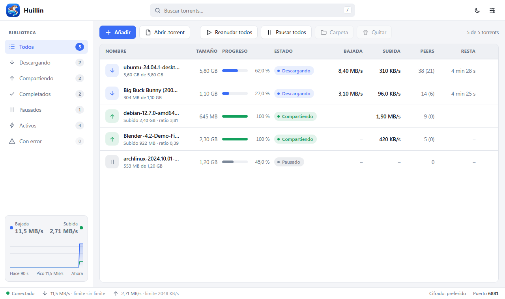
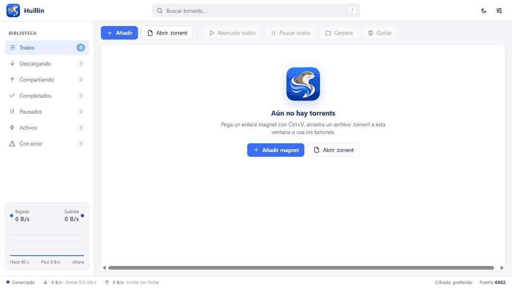
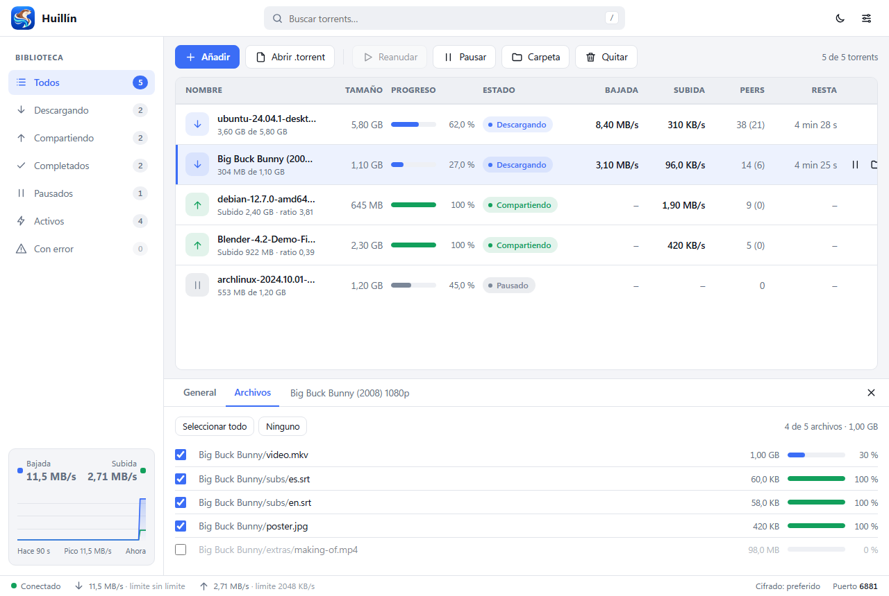
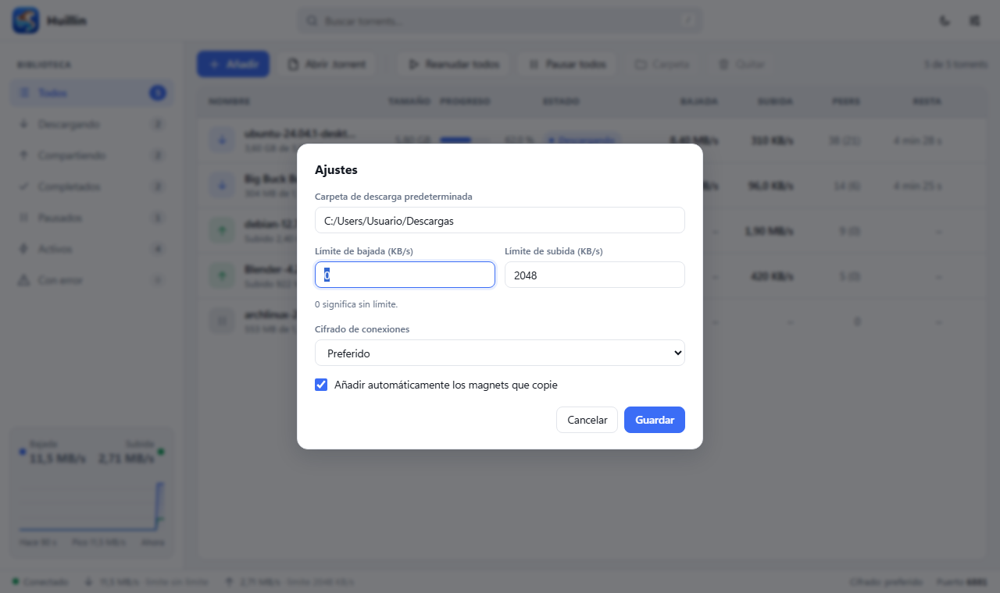

<div align="center">


# Huillín

**Cliente BitTorrent ligero para Windows, macOS y Linux, escrito en Rust.**
Rápido, sin publicidad y con una interfaz limpia.

[](https://github.com/storo/huillin/releases/latest)
[](https://github.com/storo/huillin/releases)
[](https://github.com/storo/huillin/actions/workflows/ci.yml)
[](LICENSE)


[**⬇ Descargar**](https://github.com/storo/huillin/releases/latest) · [Sitio web](https://storo.github.io/huillin/) · [Características](#características) · [Instalación](#instalación) · [Uso](#uso) · [Compilar](#compilar-desde-el-código-fuente)

</div>





<details>
<summary><b>Más capturas</b></summary>

| Archivos de un torrent | Ajustes |
| --- | --- |
|  |  |

</details>

---

## Características

- **Torrents y magnets** — añade archivos `.torrent` o enlaces `magnet:`.
- **Red completa** — DHT y trackers para encontrar peers.
- **Cifrado de protocolo (MSE)** — configurable desde la interfaz.
- **Límites de velocidad** — de subida y de bajada.
- **Portapapeles inteligente** — añade automáticamente los magnets que copies (opción desactivable en Ajustes).
- **App de escritorio nativa** — ventana propia (WebView2 / WKWebView / WebKitGTK), sin navegador ni consola.
- **Bandeja del sistema** — cierra la ventana y las descargas siguen; clic en el icono para volver.
- **Selección múltiple** — marca las casillas de los torrents o usa «Seleccionar visibles» para pausarlos, reanudarlos o quitarlos juntos. También admite Ctrl+clic y Shift+clic.
- **Instancia única** — abrir un `.torrent` o magnet con Huillín ya abierto lo añade a esa misma ventana.
- **Asociación de archivos** — `.torrent` y `magnet:` se abren con Huillín (opcional).
- **Ligero** — un solo ejecutable, sin servicios ni dependencias extra.
- **Modo web opcional** — el mismo panel disponible en el navegador (`--web`).
- **Aviso de nuevas versiones** — comprueba al abrir el panel y permite buscar desde Ajustes. Si hay una versión estable más reciente, ofrece abrir su descarga en el navegador; la instalación es manual.

## Instalación

Descarga la última versión desde la página de [**Releases**](https://github.com/storo/huillin/releases/latest):

| Archivo | Descripción |
| --- | --- |
| `Huillin-Setup-x.y.z.exe` | **Instalador** (recomendado). Acceso directo en el menú Inicio y asociación de `.torrent`/magnet opcional. No requiere permisos de administrador. |
| `Huillin-x.y.z-portable.zip` | Versión portable para Windows: descomprime y ejecuta `huillin.exe`. |
| `Huillin-x.y.z-macos-aarch64.zip` / `-x86_64.zip` | **macOS** (Apple Silicon / Intel): descomprime y arrastra `Huillin.app` a Aplicaciones. |
| `Huillin-x.y.z-linux-x86_64.tar.gz` | **Linux**: binario con `.desktop` e icono. |
| `SHA256SUMS.txt` | Sumas de verificación de los archivos anteriores. |

### Requisitos

- **Windows** 10 u 11 (64 bits).
- **macOS** 11 o superior. La app está firmada solo ad-hoc: la primera vez, clic derecho → *Abrir* (o `xattr -dr com.apple.quarantine Huillin.app`).
- **Linux** (x86_64) con `webkit2gtk-4.1`, `gtk3`, `libxdo` y `libayatana-appindicator3` (en Debian/Ubuntu: `sudo apt install libwebkit2gtk-4.1-0 libgtk-3-0 libxdo3 libayatana-appindicator3-1`). Para el portapapeles inteligente, `wl-clipboard` o `xclip`.
- Windows: [Microsoft WebView2 Runtime](https://developer.microsoft.com/microsoft-edge/webview2/): viene incluido en Windows 11 y en Windows 10 actualizado. El instalador avisa si falta.
- **No necesitas Rust ni Cargo** para usar Huillín.

> **Aviso de SmartScreen:** como el instalador aún no está firmado digitalmente, Windows puede mostrar «Windows protegió su PC». Pulsa *Más información → Ejecutar de todas formas*. Puedes comprobar la integridad del archivo con `SHA256SUMS.txt`.

El instalador Windows v0.1.0 tiene un [informe en VirusTotal](https://www.virustotal.com/gui/file/24c5575c07ca249d9f957774a25e357b8d166331f3cca18b81d3ee73a673092e). El 18 de octubre de 2026 mostraba **5 detecciones entre 71 motores** y el ejecutable portable **1/71**. Las alertas siguen sin resolver; los informes no garantizan su seguridad. [Revisión de los resultados](docs/virustotal-review.md) · [Estado del lanzamiento](docs/launch-checklist.md).

## Uso

1. Abre Huillín desde el menú Inicio.
2. Arrastra un `.torrent`, pega un magnet o haz doble clic en un archivo `.torrent` (si activaste la asociación).
3. Cierra la ventana para enviarlo a la bandeja; para salir del todo usa clic derecho en el icono → **Salir**.

### Línea de comandos

```text
huillin [archivo.torrent | magnet:?xt=...]...   Abre la app y añade los torrents indicados
huillin --web                                    Modo web: sin ventana, abre el panel en el navegador
huillin --register                               Asocia .torrent y magnet: con Huillín (usuario actual; Windows y Linux)
huillin --unregister                             Elimina esa asociación
```

### Variables de entorno

| Variable | Efecto |
| --- | --- |
| `HUILLIN_WEB=1` | Equivale a `--web`. |
| `HUILLIN_NO_BROWSER=1` | En modo web, no abre el navegador automáticamente. |

### Puertos y datos

- Panel interno: `http://127.0.0.1:8088` (o el siguiente libre hasta el `8119`), solo accesible desde tu equipo.
- Puerto BitTorrent: el primer libre entre `6881` y `6999`. Abre/redirige ese puerto en tu router para mejorar la conectividad.
- Estado y lista de torrents: `%APPDATA%\RTorrent` (Windows), `~/Library/Application Support/Huillin` (macOS), `~/.local/share/huillin` (Linux).

## Compilar desde el código fuente

Solo es necesario si quieres contribuir o probar cambios.

Requisitos: [Rust](https://www.rust-lang.org/tools/install) estable. En Linux, además:

```bash
sudo apt install libwebkit2gtk-4.1-dev libgtk-3-dev libxdo-dev libayatana-appindicator3-dev
```

```bash
git clone https://github.com/storo/huillin.git
cd huillin
cargo run --release
```

Con argumentos:

```bash
cargo run --release -- archivo.torrent "magnet:?xt=urn:btih:..."
```

### Generar el instalador

Con [Inno Setup 6](https://jrsoftware.org/isinfo.php) instalado:

```bash
cargo build --release
iscc /DAppVersion=0.1.0 installer\huillin.iss
```

El instalador queda en `dist\`.

### Publicar una versión

Las versiones se construyen solas en GitHub Actions al subir un tag:

```bash
git tag v0.1.0
git push origin v0.1.0
```

El workflow compila para Windows, macOS (Intel y Apple Silicon) y Linux, genera instalador, zips y tarball, calcula los checksums y los adjunta a la Release.

## Arquitectura

```text
┌───────────────────────────── huillin.exe ─────────────────────────────┐
│  ventana nativa (tao + wry/WebView2)  ◄── bandeja del sistema         │
│        │  http://127.0.0.1:8088                                        │
│        ▼                                                               │
│  servidor local (axum) ── UI embebida (ui/index.html)                  │
│        │                                                               │
│        ▼                                                               │
│  motor BitTorrent (tokio): sesión · torrent · DHT · trackers · MSE     │
└────────────────────────────────────────────────────────────────────────┘
```

| Módulo | Función |
| --- | --- |
| `session.rs` | Gestión de torrents, estado persistente, límites |
| `torrent.rs` | Descarga/subida por torrent, peers, piezas |
| `dht.rs`, `tracker.rs` | Descubrimiento de peers |
| `mse.rs` | Cifrado de protocolo |
| `storage.rs` | Lectura/escritura de archivos en disco |
| `web.rs` | API local y servidor de la interfaz |
| `main.rs` | Ventana, bandeja, instancia única, línea de comandos |

## Uso responsable

Huillín es una herramienta neutral de transferencia de archivos. Úsala solo para contenido que tengas derecho a descargar y compartir.

## Licencia

[MIT](LICENSE) © storo
