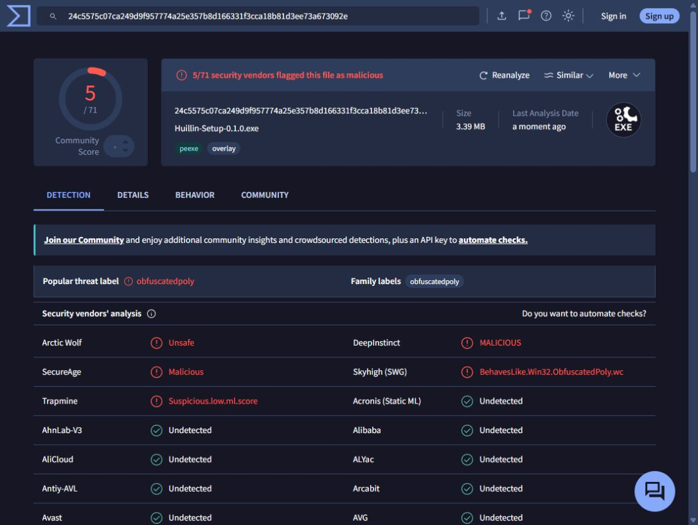

# Preparación del lanzamiento

Estado verificado el 18 de octubre de 2026.

| Punto | Estado |
| --- | --- |
| GIF demo | Listo: `demo.gif`, unos 15 s, 1080 × 608, 2,7 MB. |
| VirusTotal | Revisión realizada: instalador 5/71, portable 1/71. Alertas sin resolver; ver `virustotal-review.md`. |
| Firma Windows | Pendiente: no hay certificado configurado. Script preparado. |
| Cuenta X | Pendiente: falta correo y elección de usuario. |
| Cuenta Reddit | Pendiente: falta correo y elección de usuario; el sitio exige CAPTCHA. |

## Demo

Grabada con la interfaz real y una descarga del torrent oficial de Debian.
Muestra añadir magnet, descarga, detalles, archivos, ajustes y pausa.
Los tiempos de espera se recortaron; no se simularon velocidades ni progreso.

`cargo run --example demo` inicia una sesión independiente en
`http://127.0.0.1:8120`, con datos en `dist/demo/` y sin instancia única.
No muestra ni modifica la lista de torrents de la aplicación habitual.
Las conexiones BitTorrent funcionan como en la aplicación; al acabar la grabación,
pausar el torrent y detener el proceso de ejemplo.

El montaje de capturas JPG puede regenerarse con Pillow:

```powershell
python scripts/make-demo-gif.py --frames dist/demo-frames --manifest dist/demo-frames/edit.json
```

Las capturas originales y el montaje de esta grabación quedan en `dist/`, ignorado
por Git. Para otra grabación, capturar la sesión de ejemplo y proporcionar un JSON
con entradas `file` (nombre del JPG) y `duration` (milisegundos). Sin manifiesto,
el script usa todos los JPG en orden con una duración fija.

## VirusTotal

- Archivo: `Huillin-Setup-0.1.0.exe`, descargado de la release oficial `v0.1.0`.
- Tamaño: 3.559.409 bytes.
- SHA-256: `24c5575c07ca249d9f957774a25e357b8d166331f3cca18b81d3ee73a673092e`.
- Coincide con el `SHA256SUMS.txt` de la release.
- [Informe](https://www.virustotal.com/gui/file/24c5575c07ca249d9f957774a25e357b8d166331f3cca18b81d3ee73a673092e).
- Resultado observado: **5/71**. Arctic Wolf, DeepInstinct, SecureAge,
  Skyhigh (SWG) y Trapmine marcaron el archivo.
- No se ha determinado si las detecciones son falsos positivos. Revisarlas con
  los proveedores antes de promocionar el informe como señal de confianza.
- Una nueva compilación o firma cambia el hash: requiere un informe nuevo.

La [revisión detallada](virustotal-review.md) compara el instalador con el binario
portable y documenta los límites del análisis de comportamiento. La hipótesis de
falsos positivos es compatible con lo observado, pero no está confirmada.



## Firma de código Windows

Se necesita un certificado válido de Code Signing con acceso a su clave privada
o un servicio de firma autorizado. No se ha creado un certificado autofirmado ni
se han cambiado los avisos actuales de SmartScreen.

Con un certificado instalado y SignTool del Windows SDK:

```powershell
# 1. Compilar y firmar el binario antes de empaquetar.
cargo build --release --locked
./scripts/sign-windows.ps1 -FilePath target/release/huillin.exe -Thumbprint HUELLA_DEL_CERTIFICADO
# 2. Crear el instalador y el ZIP portable a partir del binario firmado.
iscc /DAppVersion=0.1.0 installer/huillin.iss
# 3. Firmar también el instalador.
./scripts/sign-windows.ps1 -FilePath dist/Huillin-Setup-0.1.0.exe -Thumbprint HUELLA_DEL_CERTIFICADO
# 4. Regenerar los checksums de los paquetes finales y enviarlos a VirusTotal.
```

El script usa SHA-256, sello de tiempo RFC 3161 y verifica cada firma.
La firma identifica al editor y permite comprobar que el archivo no fue alterado
después de firmarlo. No certifica ausencia de malware ni garantiza que desaparezca
SmartScreen: [reputación y firma (Microsoft)](https://learn.microsoft.com/en-us/windows/apps/package-and-deploy/smartscreen-reputation).
No está integrado en CI hasta elegir el proveedor y su método de autenticación.
La firma/notarización de macOS requiere además una identidad de Apple y su propio
flujo; el workflow actual conserva la firma ad-hoc.

Referencias: [SignTool y sello de tiempo (Microsoft)](https://learn.microsoft.com/en-us/windows/win32/seccrypto/time-stamping-authenticode-signatures),
[servidor de tiempo (DigiCert)](https://knowledge.digicert.com/solution/troubleshooting-timestamping-problems).

## Perfiles preparados para X y Reddit

Usuario propuesto, todavía sin verificar disponibilidad: `huillinapp`.

- Nombre: **Huillín**.
- Bio: Cliente BitTorrent ligero, sin publicidad y de código abierto. Hecho en Rust. Windows, macOS y Linux.
- Sitio: https://storo.github.io/huillin/
- Repositorio: https://github.com/storo/huillin
- Avatar: `ui/logo.png`.
- Demo: `docs/demo.gif`.

Falta que el propietario indique correo y nombre de usuario, complete las
verificaciones y la introducción de contraseña, y confirme las condiciones de
cada servicio en el momento de crear la cuenta. No se ha publicado contenido ni
se han añadido enlaces a perfiles que aún no existen.
