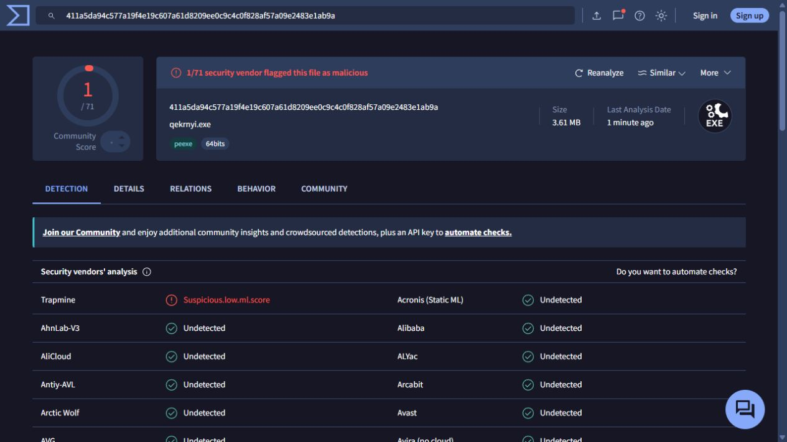

# Revisión de VirusTotal — Huillín v0.1.0

Revisión del 18 de octubre de 2026. Se leyeron las pestañas Detection,
Details y Behavior del instalador, y Detection y Behavior del ejecutable portable.
Los resultados pueden cambiar con nuevos análisis.

## Archivos comprobados

Se descargaron el instalador y el ZIP portable de la release oficial `v0.1.0`.
Ambos paquetes coinciden con `SHA256SUMS.txt`. El binario portable se extrajo sin
ejecutarlo; su hash permite consultar su informe independiente aunque VirusTotal
lo muestre con otro nombre (`qekrnyi.exe`). La identidad se establece por hash.

| Archivo | SHA-256 | Resultado observado |
| --- | --- | --- |
| Huillin-Setup-0.1.0.exe | `24c5575c07ca249d9f957774a25e357b8d166331f3cca18b81d3ee73a673092e` | 5/71 |
| huillin.exe del ZIP portable | `411a5da94c577a19f4e19c607a61d8209ee0c9c4c0f828af57a09e2483e1ab9a` | 1/71 |

[Informe del instalador](https://www.virustotal.com/gui/file/24c5575c07ca249d9f957774a25e357b8d166331f3cca18b81d3ee73a673092e/detection) ·
[Informe del portable](https://www.virustotal.com/gui/file/411a5da94c577a19f4e19c607a61d8209ee0c9c4c0f828af57a09e2483e1ab9a/detection)

## Detecciones

| Motor | Instalador | Ejecutable portable |
| --- | --- | --- |
| Arctic Wolf | Unsafe | Undetected |
| DeepInstinct | MALICIOUS | Undetected |
| SecureAge | Malicious | Undetected |
| Skyhigh (SWG) | BehavesLike.Win32.ObfuscatedPoly.wc | Undetected |
| Trapmine | Suspicious.low.ml.score | Suspicious.low.ml.score |

Microsoft, BitDefender, ESET-NOD32, Kaspersky y Malwarebytes aparecen como
`Undetected` en ambos informes. Eso significa que esos motores no detectaron una
amenaza en ese análisis, no que hayan certificado los archivos como seguros.

Las cinco etiquetas no atribuyen de forma consistente una familia concreta de
malware. `BehavesLike` y `Suspicious.low.ml.score` sugieren clasificación
heurística o mediante modelos. Esta interpretación de las etiquetas no sustituye
un diagnóstico del proveedor.

## Estructura y comportamiento

El instalador se identifica como Inno Setup y declara «Huillín Setup». VirusTotal
confirma que no tiene firma digital; la comprobación local del binario portable
también devuelve `NotSigned`.

En Details, distintas herramientas atribuyen el envoltorio a Delphi/Inno Setup,
PECompact o `.NET Reactor`. Son identificaciones automáticas y parcialmente
inconsistentes: no demuestran que el código Rust use un ofuscador. El archivo
incluye un bloque añadido al ejecutable de alta entropía, compatible con datos
comprimidos del instalador; esa explicación es una inferencia, no una validación
de su contenido.

En el informe de Jujubox del instalador se observa:

- Creación de un archivo temporal `is-…tmp/Huillin-Setup-0.1.0.tmp`.
- Ejecución de ese asistente con el parámetro `/SL5=…`.
- Lectura de claves de configuración regional de Delphi/Windows.
- Textos del asistente para elegir instalación por usuario o para todos.
- Sin detecciones de comportamiento, reglas IDS/Sigma, firmas MITRE ni
  comunicaciones de red en el resumen visible.

Esto es compatible con el arranque de un instalador Inno Setup. El árbol visible
no muestra que el asistente haya terminado ni que haya iniciado `huillin.exe`.
Por ello, ese comportamiento no valida la actividad completa del cliente.

El portable mostraba CAPA y un aviso de sandboxes aún analizando, sin actividad
dinámica suficiente para emitir una conclusión. No se interpreta `NOT FOUND`
como una prueba de ausencia de comportamiento malicioso.

## Conclusión y acciones pendientes

**Hay indicios compatibles con falsos positivos, pero no están confirmados.**
Cuatro motores detectan únicamente el instalador y Trapmine marca ambos archivos
con una etiqueta genérica. Esto concentra la sospecha en la clasificación del
empaquetado, pero no demuestra que sea la causa ni descarta una amenaza.

La revisión del informe queda realizada; las alertas siguen abiertas.
No se recomienda anunciar «0 detecciones» ni «libre de virus».

Para cerrar las alertas:

1. Solicitar revisión al fabricante de cada motor que detecta el archivo,
   adjuntando los hashes, el informe y el repositorio. No se han enviado solicitudes.
2. Completar el análisis dinámico del portable en un entorno aislado y contrastar
   los procesos, archivos y conexiones con el comportamiento esperado del cliente.
3. Documentar la procedencia de los binarios de release y sus dependencias.
4. Tras firmar o reconstruir un paquete, calcular su nuevo hash y analizar ese
   archivo final. Una firma no resuelve por sí misma una detección antivirus.

VirusTotal indica que los cambios de detección corresponden a los fabricantes,
no al agregador: [procedimiento de falsos positivos](https://docs.virustotal.com/docs/false-positive).

